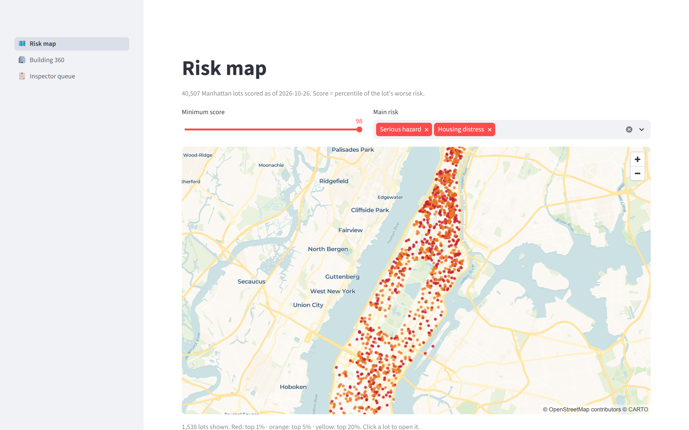
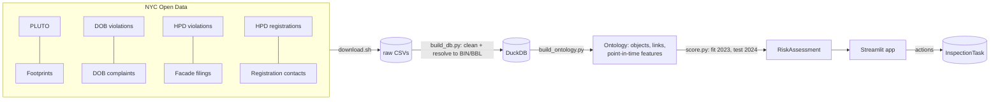
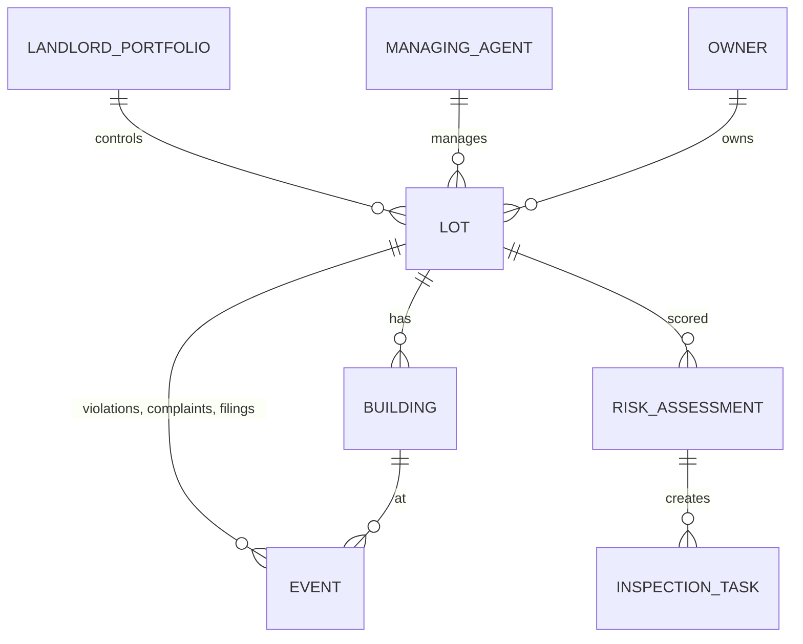
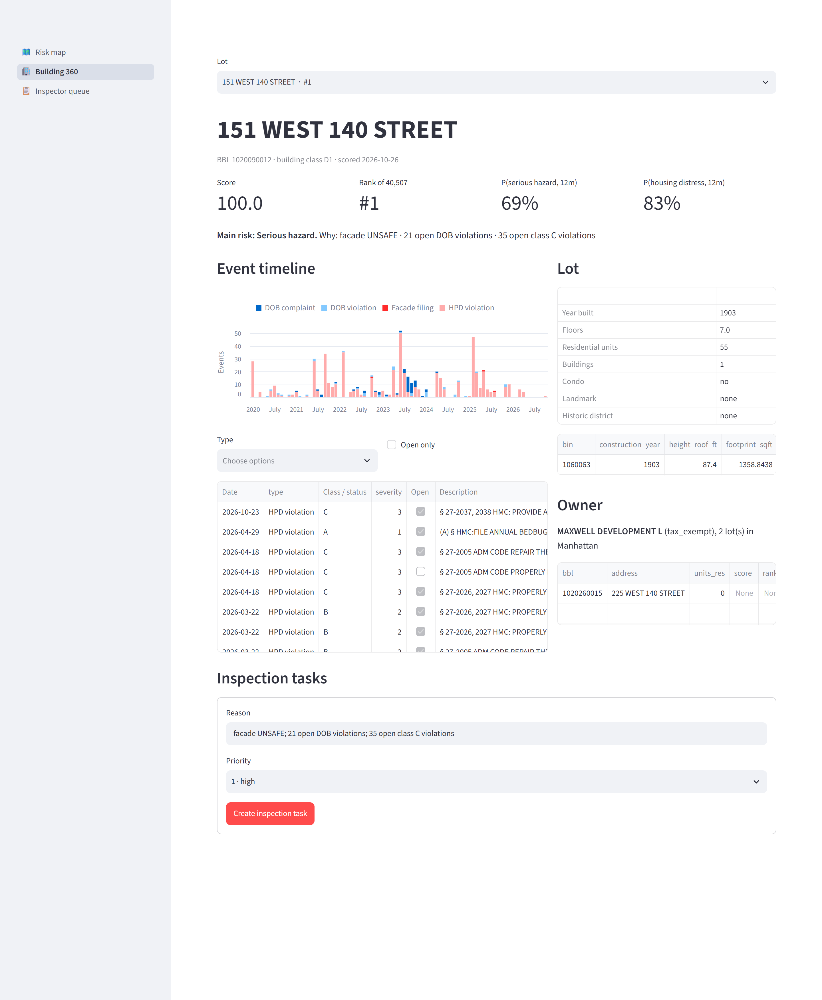
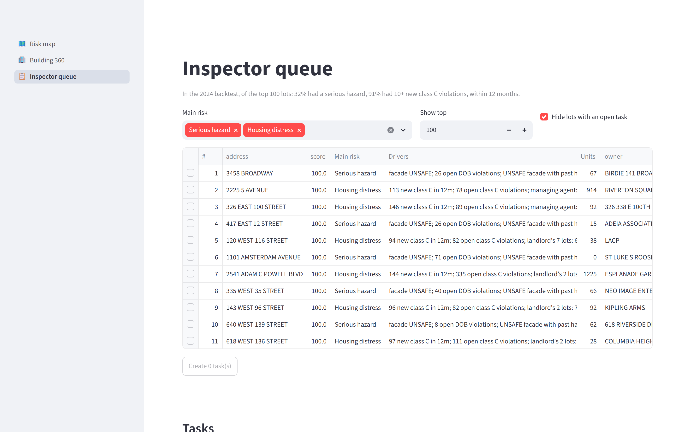

# Building-risk ontology from NYC open data

**Which Manhattan buildings should an inspector visit first, and why?**

NYC publishes building data from several agencies (DOB, HPD, DCP), and each keys it
differently. This project links eight of those datasets into one ontology of landlords,
owners, lots, buildings and events. It scores every lot's risk with an explainable model, backtests that
score on a year it never saw, and puts the result in front of a planner as a map, a building
page and a work queue whose actions are written back.

| | |
|---|---|
| **Data** | 1.28M events from 8 NYC Open Data sources, Manhattan, 2020 onward |
| **Entity resolution** | 95–99.7% of records matched to a tax lot (BBL), 89–100% to a building (BIN) |
| **Ontology** | LandlordPortfolio / ManagingAgent / Owner → Lot → Building → Event, plus RiskAssessment and InspectionTask (writeback) |
| **Landlords** | HPD registrations link single-building LLCs to the people behind them: 27.8k lots in 13k portfolios (largest: 234 lots) |
| **Backtest (2024, unseen)** | Top 100 lots: **91%** had 10+ new class C housing violations (25× the base rate); **32%** had a serious hazard (20×) |
| **App** | Streamlit: risk map, building 360, inspector queue with create / assign / record-outcome actions |

**Project page: [nyc-building-risk.vercel.app](https://nyc-building-risk.vercel.app)** ·
Write-up: [docs/writeup.md](docs/writeup.md) · Backtest: [reports/backtest.md](reports/backtest.md)



## How it works



1. **Download** ([scripts/download.sh](scripts/download.sh)): Socrata API pulls, filtered to
   Manhattan and 2020 onward.
2. **Resolve** ([scripts/build_db.py](scripts/build_db.py)): every record gets a BIN and a
   BBL. It tries the record's BIN first, then its block/lot, then condo unit lot → billing lot.
   Placeholder BINs (`1000000`) and junk dates are handled. The result is reported per source
   in `match_report`.
3. **Ontology** ([ontology/ontology.yaml](ontology/ontology.yaml),
   [scripts/build_ontology.py](scripts/build_ontology.py)): object types, link types, actions,
   and `lot_features_at(date)`, a table macro that counts only events before the date. One
   query therefore produces both backtest features and today's features, with nothing from the
   future leaking in.
   - **Landlord portfolios:** two registered lots belong to the same landlord when their HPD
     registrations share a head officer, individual or joint owner, or a corporate-owner name
     (connected components).
   - **Managing agents** are a separate object and aren't used for linking: one management
     company runs buildings for many unrelated owners.
4. **Score** ([scripts/score.py](scripts/score.py)): one logistic regression per outcome over
   0–1 components (open class C, facade status, open DOB violations, the landlord's record,
   …). The coefficients are the weights, so every score lists its top drivers in plain words.
   Which components each outcome uses is decided on a validation year (fit 2022 → validate
   2023), before the 2024 test is run once.
5. **Operate** ([app/](app/)): planners pick lots from the ranked queue, create tasks, assign
   inspectors and record outcomes. Tasks live in a separate database, so rebuilding the data
   never loses them.



## Results

Lots were scored as of 2024-01-01 using only earlier events and compared with what happened
in 2024. Learned models were fit on 2023.

| Outcome (base rate) | v3 (this score) | v2 | Gradient boosting | Naive "same as last year" | Hand-weighted v1 |
|---|---|---|---|---|---|
| Housing distress: 10+ new class C (3.6%) | **91%** · AP 0.572 | 92% · 0.563 | 91% · 0.570 | 92% · 0.510 | 59% · 0.367 |
| Serious hazard: DOB hazard or UNSAFE facade (1.6%) | **32%** · AP 0.146 | 34% · 0.143 | 41% · 0.208 | 50% · 0.138 | 21% · 0.063 |

The table shows precision in the top 100 and average precision (AP) over the full ranking.
Three findings worth stating plainly:

- **The hand-set weights lost to simple baselines.** Blending two different risks into one
  score diluted both. Fitting one model per outcome fixed it, and the result is still
  explainable.
- **The landlord's track record helps predict housing distress.** It was chosen on the
  validation year and confirmed on 2024: average precision rose from 0.563 to 0.572, now level
  with gradient boosting.
- **For hazards, a naive repeat-offender rule still wins in the top 100.** Repeat-offender
  components looked like a big gain on the validation year (23% → 35%) but didn't carry over
  to 2024 (34% → 32%). With about 660 hazard lots, top-100 precision has roughly ±5 points of
  noise. I didn't tune further against the test year.

## Screenshots

**Building 360**: score, drivers, event timeline, lot facts, who controls it (landlord
portfolio with their other buildings' scores, managing agent), create task.



**Inspector queue**: ranked lots, multi-select to create tasks, then assign and record outcomes.



## Run it

```bash
uv venv --python 3.12 .venv && uv pip install --python .venv -r requirements.txt
bash scripts/download.sh                          # ~480 MB into data/raw
.venv/Scripts/python scripts/build_db.py          # -> data/building_risk.duckdb
.venv/Scripts/python scripts/build_ontology.py
.venv/Scripts/python scripts/score.py             # -> reports/backtest.md
.venv/Scripts/streamlit run app/app.py            # http://localhost:8501
```

(`bin/` instead of `Scripts/` on macOS/Linux.) Stop the app before re-running the build
scripts: it holds a read lock on the database. `scripts/screenshots.py` regenerates the
images above from the running app.

```sql
-- Explore in DuckDB
select * from match_report;                          -- entity-resolution rates
select * from lot_features_at(DATE '2024-01-01');    -- point-in-time features
select * from risk_assessment where as_of = current_date order by rank limit 20;
```

## Limits

- **Outcomes are recorded violations,** so they partly reflect where agencies choose to
  inspect. The score predicts "will get a serious violation", not "is unsafe".
- **Landlord linking uses exact names.** A name spelled two different ways in separate
  registrations stays split. Managing-agent names aren't normalized either ("STELLAR MGMT" vs
  "STELLAR MANAGEMENT"). Only HPD-registered rentals (about 28k of 40.5k lots) have a
  portfolio.
- **HPD violations carry only block/lot,** so their BIN is known only when the lot has one
  building.
- **Building attributes and landlord links are today's values,** even in the backtest.
