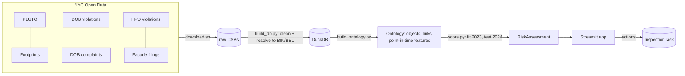
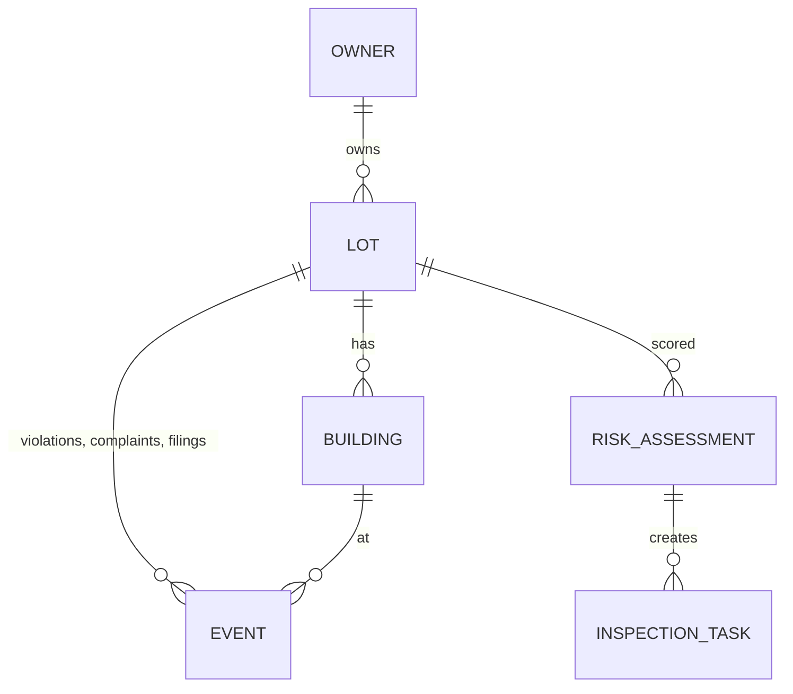

# Building-risk ontology from NYC open data

**Which Manhattan buildings should an inspector visit first, and why?**

NYC publishes building data from several agencies (DOB, HPD, DCP), and each keys it
differently. This project links six of those datasets into one ontology of owners, lots,
buildings and events. It scores every lot's risk with an explainable model, backtests that
score on a year it never saw, and puts the result in front of a planner as a map, a building
page and a work queue whose actions are written back.

| | |
|---|---|
| **Data** | 1.22M records from 6 NYC Open Data sources, Manhattan, 2020 onward |
| **Entity resolution** | 95–99.7% of records matched to a tax lot (BBL), 89–100% to a building (BIN) |
| **Ontology** | Owner → Lot → Building → Event, plus RiskAssessment and InspectionTask (writeback) |
| **Backtest (2024, unseen)** | Top 100 lots: **92%** had 10+ new class C housing violations (25× the base rate); **34%** had a serious hazard (21×) |
| **App** | Streamlit: risk map, building 360, inspector queue with create / assign / record-outcome actions |

Write-up: [docs/writeup.md](docs/writeup.md) · Backtest: [reports/backtest.md](reports/backtest.md)


## How it works



1. **Download** ([scripts/download.sh](scripts/download.sh)): Socrata API pulls, filtered to
   Manhattan and 2020 onward.
2. **Resolve** ([scripts/build_db.py](scripts/build_db.py)): every record gets a BIN and a
   BBL. It tries the record's BIN first, then its block/lot, then condo unit lot → billing lot.
   Placeholder BINs (`1000000`) and junk dates are handled. The result is reported per source
   in `match_report`.
3. **Ontology** ([ontology/ontology.yaml](ontology/ontology.yaml),
   [scripts/build_ontology.py](scripts/build_ontology.py)): object types, link types, actions,
   and `lot_features_at(date)`, a table macro that counts only events before the date. One
   query therefore produces both backtest features and today's features, with nothing from the
   future leaking in.
4. **Score** ([scripts/score.py](scripts/score.py)): one logistic regression per outcome over
   0–1 components (open class C, facade status, open DOB violations, …). The coefficients are
   the weights, so every score lists its top drivers in plain words.
5. **Operate** ([app/](app/)): planners pick lots from the ranked queue, create tasks, assign
   inspectors and record outcomes. Tasks live in a separate database, so rebuilding the data
   never loses them.



## Results

Lots were scored as of 2024-01-01 using only earlier events and compared with what happened
in 2024. Learned models were fit on 2023.

| Outcome (base rate) | This score | Gradient boosting | Naive "same as last year" | My first hand-weighted score |
|---|---|---|---|---|
| Housing distress: 10+ new class C (3.6%) | **92%** | 91% | 92% | 59% |
| Serious hazard: DOB hazard or UNSAFE facade (1.6%) | **34%** | 42% | 46% | 21% |

The table shows precision in the top 100. Two findings worth stating plainly:

- **The hand-set weights lost to simple baselines.** Blending two different risks into one
  score diluted both. Fitting one model per outcome fixed it, and the result is still
  explainable.
- **For hazards, a naive repeat-offender rule still wins in the top 100.** Buildings with an
  unsafe facade keep getting hazard violations. The learned score is better across the whole
  ranking (average precision 0.143 vs 0.138), but not at the very top.

## Screenshots

**Building 360**: score, drivers, event timeline, lot facts, owner portfolio, create task.


**Inspector queue**: ranked lots, multi-select to create tasks, then assign and record outcomes.


## Run it

```bash
uv venv --python 3.12 .venv && uv pip install --python .venv -r requirements.txt
bash scripts/download.sh                          # ~470 MB into data/raw
.venv/Scripts/python scripts/build_db.py          # -> data/building_risk.duckdb
.venv/Scripts/python scripts/build_ontology.py
.venv/Scripts/python scripts/score.py             # -> reports/backtest.md
.venv/Scripts/streamlit run app/app.py            # http://localhost:8501
```

(`bin/` instead of `Scripts/` on macOS/Linux.) Stop the app before re-running the build
scripts: it holds a read lock on the database. `scripts/screenshots.py` regenerates the
images above from the running app.

```sql
-- Explore in DuckDB
select * from match_report;                          -- entity-resolution rates
select * from lot_features_at(DATE '2024-01-01');    -- point-in-time features
select * from risk_assessment where as_of = current_date order by rank limit 20;
```

## Limits

- **Outcomes are recorded violations,** so they partly reflect where agencies choose to
  inspect. The score predicts "will get a serious violation", not "is unsafe".
- **The DOB complaints data ends 2024-04-15**, when DOB moved to DOB NOW, which isn't loaded.
  The model doesn't use complaints.
- **Owner portfolios are undercounted:** most Manhattan buildings each sit in their own LLC.
  HPD registrations would link them through the managing agent.
- **HPD violations carry only block/lot,** so their BIN is known only when the lot has one
  building.
- **Building attributes (owner, floors, units) are today's values,** even in the backtest.
